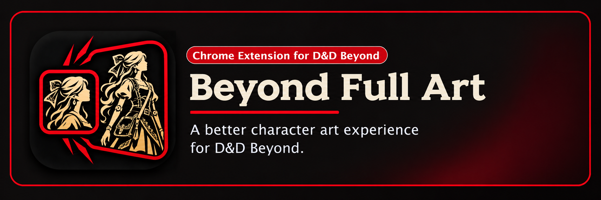
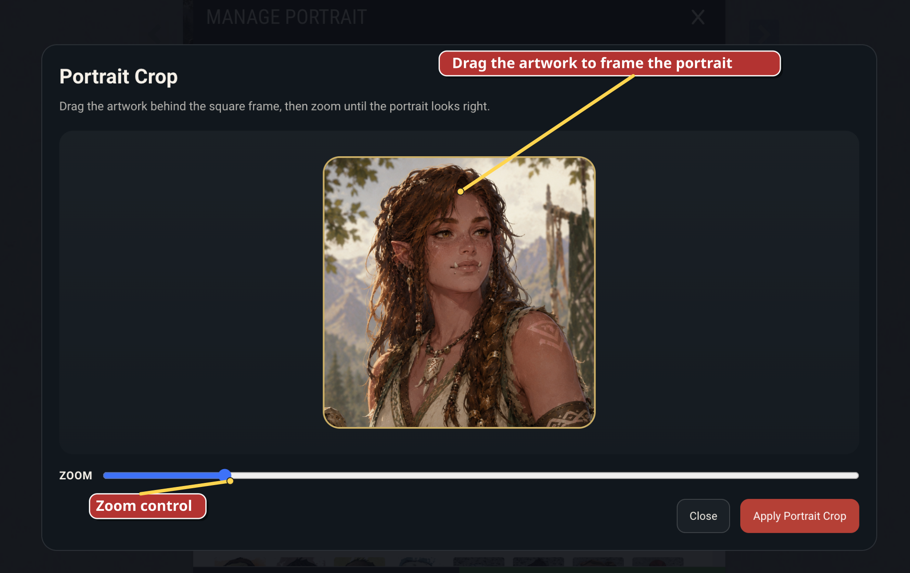
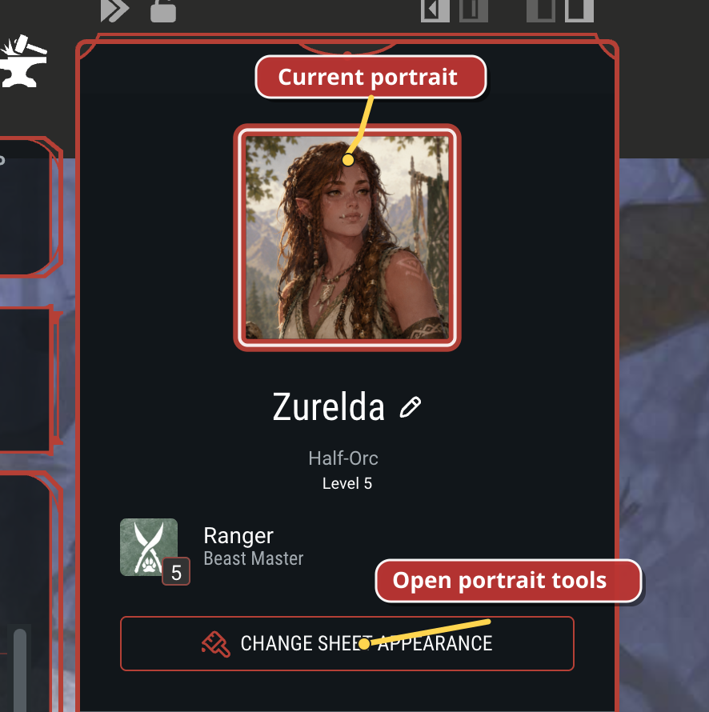
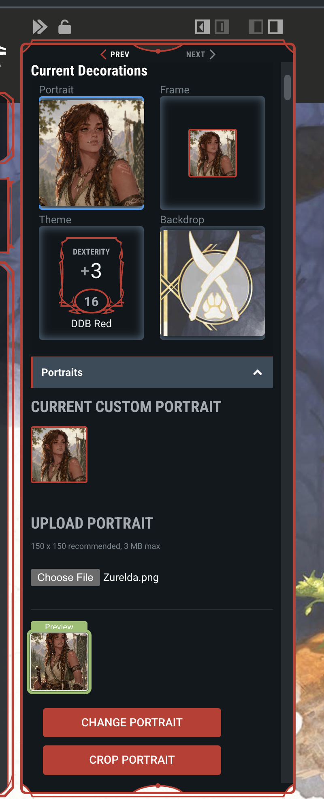
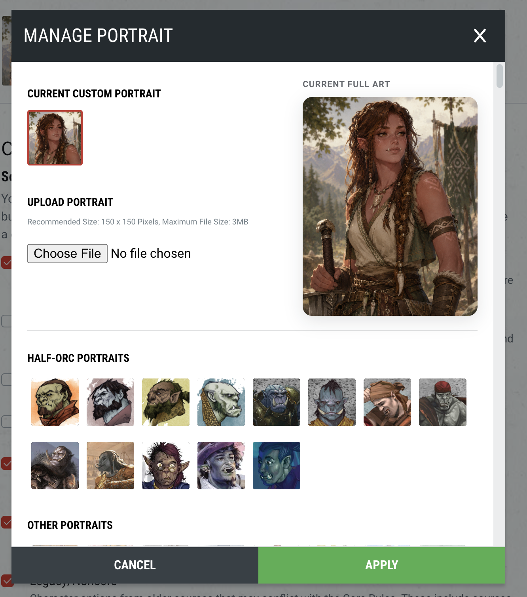

<p align="center">
  
</p>

Beyond Full Art is a Chrome Manifest V3 extension for D&D Beyond character art. It keeps D&D Beyond's portrait flow and adds local full-art storage, a portrait crop tool, a fullscreen viewer, sharper character-card portraits, a companion portrait, and a local character journal.

This file is the runbook: what the extension does, how to install it, and how to build, run, and test it. Product and architecture detail lives in `docs/`. The D&D Beyond sheet reference is [docs/ddb-reference/README.md](docs/ddb-reference/README.md). The journal note panel follows the Information Sidebar in [docs/ddb-reference/sidebar.md](docs/ddb-reference/sidebar.md). Shipped features are listed in `.agent/FEATURES.md`. Work that has not shipped lives in `.agent/plans/` and follows `.agent/PLANS.md`. Agent-facing conventions live in `AGENTS.md`.

## The problems it solves

### Cropping full-size character art can be awkward

If you start with a full illustration, getting the portrait framing right is awkward. You usually have to crop the image somewhere else first, upload it, then repeat the process until it looks right.

Beyond Full Art adds an in-browser portrait crop flow so you can frame the portrait you want while keeping the original full image.

### Character art is often too small to fully appreciate

Portraits on the sheet are tiny. That means it is hard to appreciate your own character art, and it is even harder to get a nice look at another player's character in a campaign.

Beyond Full Art adds a fullscreen viewer so character art can actually be seen at a useful size.

## Features

The toolbar icon opens one popup. That popup holds the optional settings and the stored-art inventory.

### Fullscreen viewer

On a character sheet, the extension makes the portrait in the right-side information panel open a fullscreen overlay. If full art is stored for that character, the viewer shows that image. Otherwise it shows the current D&D Beyond portrait. Escape, the close button, or the backdrop dismisses it, and focus returns to the portrait.

### Portrait edit panel

Inside D&D Beyond's portrait manager (the sheet sidebar and the builder modal), the extension injects its own status and actions. That panel shows the current stored full art, a preview of a newly chosen image, and **Crop portrait** or **Edit portrait crop**. Narrow sidebars use a compact layout. It keeps D&D Beyond's file picker and saves the selected file locally only after the native **Change Portrait** button is used.

### Portrait crop

The crop dialog frames a square from the stored full art, or from a file that has been chosen but not yet confirmed. Applying the crop produces a 512×512 PNG and hands it back through D&D Beyond's existing portrait upload input. The original full art stays stored separately. Replacing the full art invalidates the saved crop.

### Art download and removal

When the viewer is showing stored full art, **Download full art** saves that file through a normal browser download. The same viewer can **Remove stored full art**. Removal deletes the stored full art. The D&D Beyond portrait stays as it is. Downloads use a temporary link and the existing `storage` permission.

### Extension popup: settings and stored content

Click the toolbar icon to open the popup.

- **Sharper card portraits** upgrades small campaign and My Characters avatars to a sharper image URL. It is on by default.
- **Character Journal** shows or hides the sheet's Journal tab. Turning it off does not delete entries. It is on by default. Its list is compact by default; optional controls add updated dates, text previews, and image thumbnails.
- **Companion portrait** shows selection checkboxes in Extras and the chosen portrait beside the character portrait. Turning it off keeps the saved choice. It is on by default.
- **Backup folder** prepares one empty folder, or reconnects a folder this extension already prepared. The setup window can copy art and notes into that folder, check the files, and then remove the copies in this browser. New art and notes save in the folder. A prepared folder is read in place. If this browser asks, choose the folder again and allow access. **Check folder** re-reads it and refreshes the inventory. Put the folder inside Google Drive for Desktop if you want Drive to sync it.
- When that folder is the library, deleting art or a journal entry records the deletion there. Deleted notes do not silently return, and their photo files are retained so setup can restore a browser copy explicitly.
- **Local storage** shows how much of Chrome's about 10 MB extension cap notes and settings are using, and Chrome's separate IndexedDB estimate for images.
- **Stored content** groups local full art and journals by character. Each character can be opened, its art downloaded or deleted, and its journal exported or imported. Journal exports are ZIP files with Markdown notes, photos, and versioned recovery data. **Export all journals** and **Import backup** support whole-extension recovery, including a fresh install with no stored characters yet.

#### Back up and restore journals

Use **Export all journals** before updating or removing the extension. The ZIP
contains readable Markdown notes and ordinary photo files under each character
ID, plus `backup.json` for reliable restoration. A character row can export
only that journal.

Use **Import backup** and select the exported ZIP to restore it. Import merges
by the stable note ID: missing notes are added, the newest `updatedAt` version
wins, unrelated local notes remain, and existing photo blobs are not
overwritten. Selecting **Import** on a character row accepts only that
character from the backup. Older HTML backups remain importable.

### Character card portraits

On campaign pages and `https://www.dndbeyond.com/characters`, enabled card portraits swap to a larger avatar URL after the page renders. A card pulses while it upgrades and flashes briefly when the sharper image is in place.

### Companion portrait

On a character sheet, the extension enlarges the header portrait and adds a little space before the character name. Each usable row in **Extras** gains a small checkbox over its image. Selecting one stores that choice for the current character and places the Extra's portrait over the header portrait's bottom-right corner. Clicking that portrait opens the Extra's native D&D Beyond sidebar, where its stats and hit points can be managed normally. The companion border follows the sheet's character theme color. Selecting another Extra replaces it; clearing the checkbox removes the overlay.

### Character journal

On a character sheet, a **Journal** tab is inserted after D&D Beyond's **Extras** tab. This is the shipped beta. Search, **Filter**, and **New Note** sit on one toolbar. The list shows each title with a quiet creation date by default; popup settings can additionally show the updated date, text preview, and image thumbnail. Search always checks the complete note content even when its preview is hidden. Choosing a note opens a slide-in panel that mirrors the Information Sidebar in [docs/ddb-reference/sidebar.md](docs/ddb-reference/sidebar.md). Read mode renders markdown. **Edit** switches to the source, with an icon toolbar. Photos sit in the note as `![[img:<id>|caption|width]]`, inserted at the cursor by the image button, paste, or drop. PNG, JPEG, and WebP files over 3 MB are resized (longest edge 2048px) and stored under 3 MB. A file over 25 MB is refused. Note text stays in `chrome.storage.local`. Photo bytes stay in extension-origin IndexedDB. The tab, the list, and the panel follow the sheet's light and dark appearance. Nothing is written to D&D Beyond notes, backstory, or extras. The UI lives in `src/features/character-journal/`.

### Not built yet

Character-deletion cleanup is specified in `docs/PRODUCT_SPEC.md` and researched in `docs/NETWORK_DELETE_RESEARCH.md`. The extension does not yet notice when a D&D Beyond character is deleted, and it does not offer to delete the matching local art.

## Screenshots

<table>
  <tr>
    <td align="center" valign="top">
      <strong>Fullscreen art viewing</strong>
      <br />
      Open character art at a size that actually lets you appreciate it.
      <br /><br />
      
    </td>
    <td align="center" valign="top">
      <strong>Better portrait cropping</strong>
      <br />
      Frame a square portrait from full-size art without leaving D&amp;D Beyond.
      <br /><br />
      
    </td>
  </tr>
</table>

### Where to find these in D&D Beyond

<p align="center">
  <strong>Character sheet</strong><br />
  Open the normal portrait area on the character sheet to view art fullscreen, then use the portrait tools in the sidebar.
</p>
<p align="center">
  
  
</p>

<p align="center">
  <strong>Builder modal</strong><br />
  Use the portrait manager in the builder to save full art, preview the portrait crop, and keep the portrait and artwork connected in one flow.
</p>
<p align="center">
  
  
</p>

## Install

There is no Chrome Web Store release yet. Install the unpacked build.

### 1. Build the extension

Node.js 20 is required (`.nvmrc` is `20.18.0`).

```bash
nvm use
npm install
npm run build
```

If your local `node` path is not already active, use:

```bash
PATH="$HOME/.nvm/versions/node/$(cat .nvmrc)/bin:$PATH" npm run build
```

The build writes a loadable extension to `dist/`. Chrome loads those compiled files directly.

### 2. Load it in Chrome

1. Open `chrome://extensions`.
2. Turn on **Developer mode**.
3. Click **Load unpacked**.
4. Select this repository's `dist/` folder.

## How to use

### View full art

1. Open a D&D Beyond character sheet.
2. Click the normal portrait to open D&D Beyond's portrait pane.
3. Click the portrait inside that pane.
4. The extension opens the image fullscreen.

### Save full art

1. Open D&D Beyond's portrait manager.
2. Choose a portrait image through D&D Beyond's normal upload flow.
3. Click D&D Beyond's native portrait confirmation button.
4. The extension saves that same source image locally as full art.

### Crop a portrait

1. Open the portrait manager after full art is available.
2. Choose **Crop portrait** or **Edit portrait crop**.
3. Drag and zoom until the portrait framing looks right.
4. Apply the crop.
5. Finish the D&D Beyond portrait flow if it asks you to confirm the change.

### Download or remove stored art

1. Open the fullscreen viewer for a character that has stored full art.
2. Choose **Download full art** or **Remove stored full art**.
3. Or open the toolbar popup and use **Download** or **Delete** on that character's inventory row. **Open** goes to the character sheet.

### Sharper card portraits

1. Click the extension icon in Chrome.
2. Enable or disable **Sharper card portraits**.
3. Open a D&D Beyond campaign page or the My Characters page.
4. When enabled, character cards progressively swap to a sharper portrait source after the page renders.

### Show a companion portrait

1. Leave **Companion portrait** enabled in the popup.
2. Open a character sheet and choose **Extras**.
3. Check the small box on the Extra whose portrait should appear beside the character portrait.
4. Click the companion portrait to open that Extra's native sidebar.
5. Clear the checkbox to remove the overlay, or select a different Extra to replace it.

### Use the character journal

1. Leave **Character Journal** enabled in the popup.
2. Leave the list compact, or enable **Updated date**, **Text preview**, and **Image thumbnail** under **Journal list details**.
3. Open a character sheet and choose **Journal**, immediately after **Extras**.
4. Choose **New Note** to create a note in the side panel. Pick its type there.
5. Read the note in that panel. Markdown renders in read mode. **Edit** changes it. The note saves on its own. **Close**, in the pane chrome, returns to the list.
6. Search titles, tags, and complete note text. **Filter** selects one or more types. `[[Name]]` links to another note. A missing name stays unresolved until autocomplete creates it.
7. Use **Image**, paste, or drop a PNG, JPEG, or WebP photo while editing. The note gains `![[img:<id>]]` at the cursor. Add `|caption` or `|300` (pixels) inside the brackets to set the caption or width. Cut and paste that embed to move the picture. A photo over 3 MB is resized to fit. A photo over 25 MB is refused, and the note text stays.
8. Choose a native D&D Beyond tab to return to the sheet. Disabling the popup setting hides the Journal tab and leaves the saved entries in place.

## Developer runbook

### Architecture

```text
D&D Beyond tab
  -> content scripts (sheet, card portraits)
  -> feature UI (viewer, edit panel, crop dialog, journal)
  -> runtime messages
  -> service worker
       -> chrome.storage.local (metadata, preferences, journal text)
       -> IndexedDB (full-art, crop, and journal photo bytes)

Toolbar popup
  -> the same storage and art messages
```

| Path | Role |
| --- | --- |
| `src/content/` | Content-script entrypoints. The sheet entry installs the page features. |
| `src/features/` | Viewer, art controls, crop, card portraits, and journal UI. |
| `src/features/character-journal/` | Journal tab, slide-in note panel, markdown, and photo embeds. |
| `src/platform/dndbeyond/selectors.ts` | The only D&D Beyond selector map. A renamed class is a one-line edit here. |
| `src/platform/dndbeyond/` | URL parsing and the DOM adapters that import the map. |
| `src/platform/chrome/` | Storage, IndexedDB, and runtime-message validation. |
| `src/background/service-worker.ts` | Owns art reads and writes. Treat it as ephemeral. |
| `src/popup/` | Toolbar popup: three settings, the backup folder, the storage readout, and the stored-art inventory. |
| `src/folder/` | Window where Chrome's directory picker prepares the backup folder. |
| `src/shared/` | Small DOM, download, and result helpers. |
| `tests/unit`, `tests/dom`, `tests/e2e` | Pure logic, jsdom fixtures, and Playwright extension fixtures. |
| `docs/ddb-reference/` | Living reference for Matilda Greywolf's sheet: layout, tabs, theme, and the hooks the extension uses. |
| `docs/` | Spec, architecture, decisions, test checklists, and deletion research. |
| `.agent/` | Shipped feature list and future plans. |

D&D Beyond selectors and private endpoints are unstable. Every selector the extension depends on is in `src/platform/dndbeyond/selectors.ts`. The sheet layout, including where the tab row sits on a wide desktop, is in [docs/ddb-reference/README.md](docs/ddb-reference/README.md). The journal note panel follows [docs/ddb-reference/sidebar.md](docs/ddb-reference/sidebar.md). The longer design notes are in [docs/ARCHITECTURE.md](docs/ARCHITECTURE.md).

### Commands

| Command | What it does |
| --- | --- |
| `npm run build` | Clean `dist/` and bundle the extension. |
| `npm run watch` | Rebuild the script bundles when source changes. Leave it running while you work. |
| `npm run typecheck` | Strict TypeScript check. No emit. |
| `npm test` | Vitest unit and DOM tests. |
| `npm run test:e2e` | Build, then run Playwright against local fixtures. |
| `npm run test:all` | Typecheck, unit/DOM tests, build, and Playwright. |

`npm run watch` copies `manifest.json`, icons, and `src/popup/settings.html` once at startup. After editing those static files, stop watch and run `npm run build`. CSS imported with `?raw` is part of the script bundles, so watch does rebuild it.

### Start and stop

This is an unpacked extension, not a server.

1. Run `npm run build`, or leave `npm run watch` running.
2. Load `dist/` from `chrome://extensions`, as in [Install](#install).
3. Open a D&D Beyond character, campaign, or My Characters page.

After a source change:

1. Let `npm run build` or the watch rebuild finish.
2. Click **Reload** on the Beyond Full Art card in `chrome://extensions`.
3. Refresh the D&D Beyond tab so the content scripts load again.

Stop it without deleting saved art by turning the extension off in `chrome://extensions`. **Remove** uninstalls it and drops extension storage, including local art and journal entries. Stop `npm run watch` with Ctrl+C. That stops the rebuild process.

### Tests

Automated tests use saved DOM fixtures and do not call the live site. Playwright routes D&D Beyond URLs to those fixtures. If Chromium is missing, run `npx playwright install chromium` once. Headed debugging:

```bash
BFA_PLAYWRIGHT_HEADLESS=false npm run test:e2e
```

`npm test` includes the selector health check. A failure names the selector, the features it breaks, what it targeted, and what to look for. The usual fix is one line in `src/platform/dndbeyond/selectors.ts`.

The live check is skipped unless you point it at a logged-in sheet. The command, the reference character, and the storage-state setup are in [docs/TESTING.md](docs/TESTING.md#selector-health). `npm run test:e2e` skips this check when the URL is unset.

Manual checklists for the live site are in [docs/TESTING.md](docs/TESTING.md). Read [docs/ddb-reference/README.md](docs/ddb-reference/README.md) instead of browsing the live site for structure. A change that touches a D&D Beyond adapter still needs a live check; the fixture suite cannot prove the current site DOM.

### Where to read next

- [docs/PRODUCT_SPEC.md](docs/PRODUCT_SPEC.md)
- [docs/ARCHITECTURE.md](docs/ARCHITECTURE.md)
- [docs/IMPLEMENTATION_PLAN.md](docs/IMPLEMENTATION_PLAN.md)
- [docs/DECISIONS.md](docs/DECISIONS.md)
- [docs/ddb-reference/README.md](docs/ddb-reference/README.md)
- [docs/TESTING.md](docs/TESTING.md)
- [AGENTS.md](AGENTS.md)

## Privacy

- Your artwork and journal entries are stored locally in your browser.
- The extension does not upload your art to an external service.
- Removing the extension removes access to the stored local art and journal entries.
- There is currently no cloud sync.

## Storage expectations

- For normal use, local storage should be fine.
- Storage use grows as you save more full-art images.
- If you save artwork for a lot of characters, the extension can start taking up a noticeable amount of browser storage.
- The biggest factor is the size of the original images you save.
- Right now, the extension keeps one active full-art image per character, plus any saved portrait crop for that character.
- Supported uploads are PNG, JPEG, and WebP, up to 3 MB.
- If you expect to store art for a large roster, occasionally remove artwork you no longer need.

## Current status

Available now:

- Fullscreen art viewer
- Local full-art storage
- Portrait edit panel inside D&D Beyond's portrait manager
- Portrait crop workflow
- Full-art download from the viewer and from the popup inventory
- Optional character-card portrait enhancement
- Manual removal of stored full art
- Character journal (beta)
- Journal ZIP backup and merge-safe restore from the extension popup
- Companion portrait selected from Extras

Planned next:

- Companion name, stats, health, and controls below the character header
- Cleanup of local art and journal data when a D&D Beyond character is deleted

## Known limits

- No Chrome Web Store release yet.
- Until a backup folder is the library, art and notes are tied to the browser where the extension is installed. After that, the folder holds them. Popup settings stay on this browser.
- Only one active full-art image is stored per character right now.
- The popup storage readout measures usage. It does not raise the cap. Notes and settings share Chrome's about 10 MB extension cap. Image bytes live in IndexedDB until a folder is the library, and that line is Chrome's estimate for this extension.
- Choosing a backup folder prepares that folder. The setup window copies checked files, then asks to remove this browser's copies. It does not copy over a character the folder already has. If a note or photo was edited after the copy, both copies stay and this browser keeps saving locally. A new folder has to be empty. Drive sync requires the folder to be on disk, such as inside Google Drive for Desktop. An open sheet does not watch automatically; use **Check folder** in the popup or the **Sync folder** icon in the Journal.
- Folder-library deletes leave checked tombstones. Setup can leave deleted or restore the browser copy for notes, photos, full art, and crops.
- The extension compares browser and folder records by stable IDs, note contents, and image hashes. Setup can add non-conflicting browser-only records, verify them, and then use the folder. Drive conflict-copy filenames are reported without being opened. Every conflict requires a reviewed choice before writes begin.
- Choosing another directory while a folder is already the library requires confirmation. Cancelling keeps the current folder connected.
- Setup resolves notes by keeping the folder note, browser note, or both. Deleted records can stay deleted or be restored. For full art and crops, the selected image becomes current and the other checked bytes remain beside it as a timestamped `kept` file. Conflicting photos retain both byte versions; the version owned by the newer note keeps its id and the other note is remapped to a new photo id.
- Journal photos are one image per add, in PNG, JPEG, or WebP. The note body places each one with `![[img:<id>|caption|width]]`. Files between 3 MB and 25 MB are resized before storage. Files over 25 MB are refused. Stored bytes stay at or under 3 MB. Export and import are available in the popup.
- Journal ZIP folders use the stable D&D Beyond character ID. Using the full character name reliably is deferred.
- A long journal title is cut off in the edit-mode input. A plain line right after a list item joins that bullet, which is ordinary markdown.
- Companion display is portrait-only and supports one selected Extra per character. It reuses the exact image URL D&D Beyond rendered; name, stats, health, and controls are deferred.

## Disclaimer

This is an independent fan-made extension. It is not affiliated with or endorsed by D&D Beyond or Wizards of the Coast.
