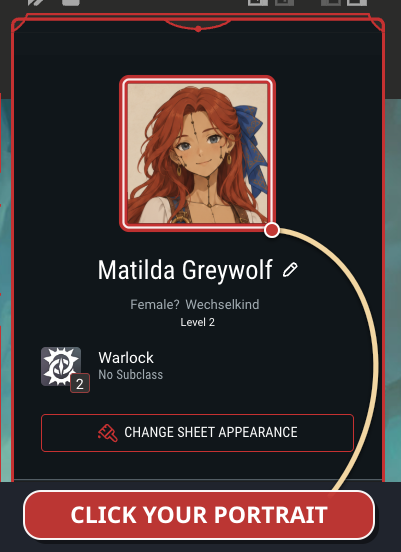
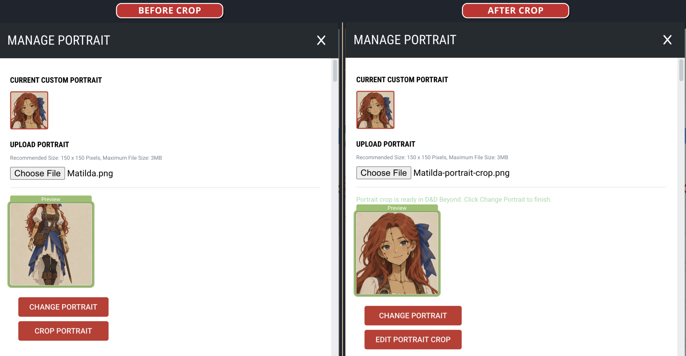
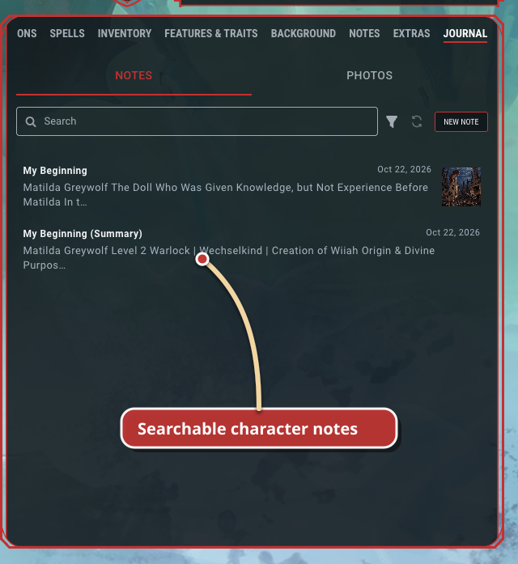
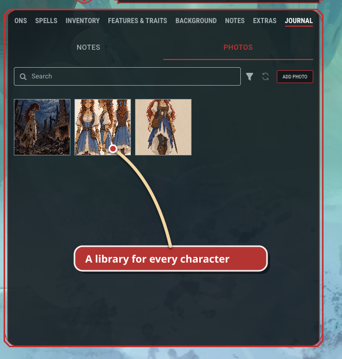
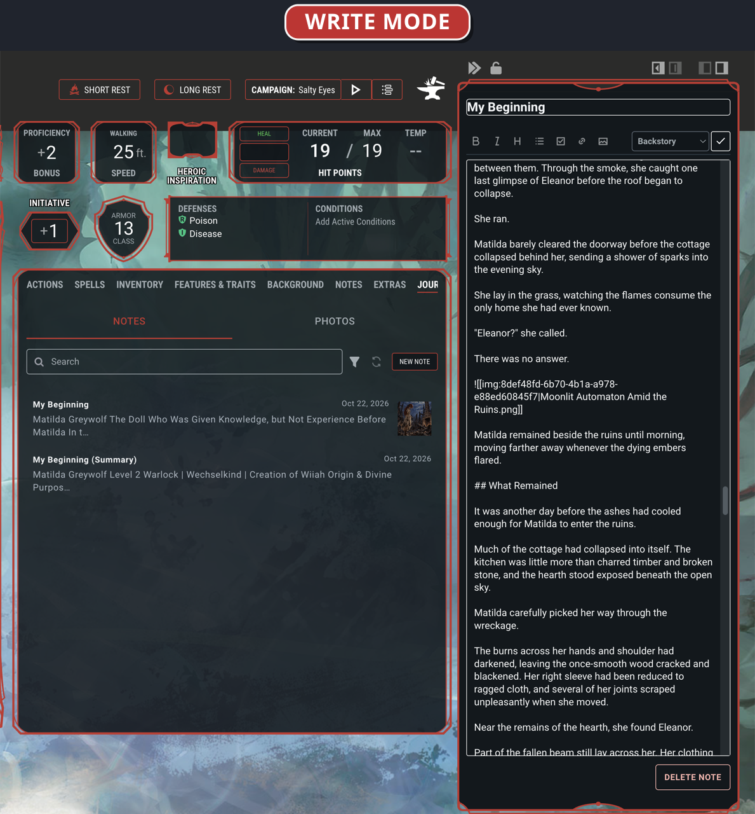
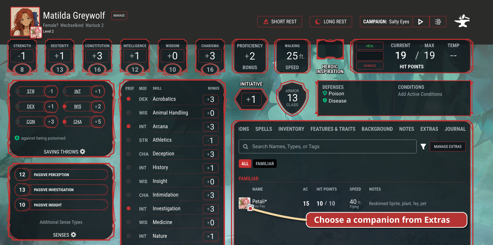
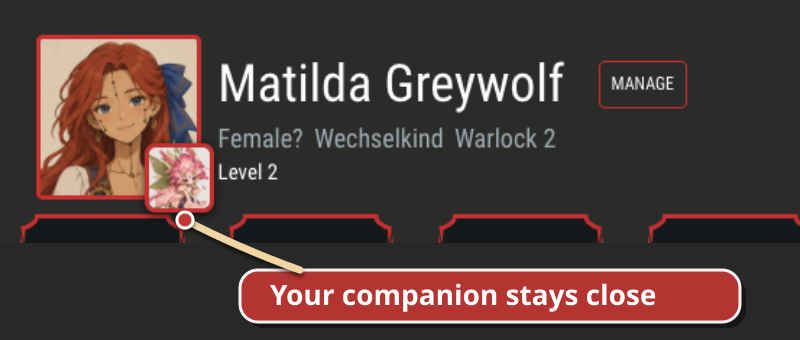

<p align="center">
  
</p>

<h1 align="center">Beyond Full Art</h1>

<p align="center"><strong>See the whole character. Keep the whole story.</strong></p>

<p align="center">
  Beyond Full Art is an open-source Chrome extension that adds full-size character art,
  portrait cropping, a private local journal, photos, and companions directly to D&amp;D Beyond.
</p>

<p align="center">
  <a href="#install">Install</a> ·
  <a href="#made-for-your-character">Features</a> ·
  <a href="docs/USAGE.md">How to use</a> ·
  <a href="PRIVACY.md">Privacy</a>
</p>

<p align="center">
  <a href="https://ko-fi.com/dpack1"></a>
</p>

## Install

> [!NOTE]
> Beyond Full Art is not in the Chrome Web Store yet. Install the unpacked
> extension from this repository.

You need [Node.js 20](https://nodejs.org/) (`.nvmrc` currently uses `20.18.0`).

```bash
nvm use
npm install
npm run build
```

Then open `chrome://extensions` in Chrome:

1. Turn on **Developer mode**.
2. Choose **Load unpacked**.
3. Select this repository's `dist/` folder.

Chrome loads `dist/`, not the repository root. After rebuilding, use **Reload**
on the extension card and refresh the D&D Beyond tab.

## Made for your character

### Keep the art, choose the portrait

Save the original illustration while using a square crop for D&D Beyond's
portrait. The fullscreen viewer gives the artwork room to breathe; the crop
tool keeps the whole workflow inside the character sheet.

| Click the character portrait | View the full character |
| --- | --- |
|  |  |

### Crop first, preview before applying

Start from the character sheet or the character builder. Drag and zoom the
artwork inside the square crop, inspect the portrait preview, then let D&D
Beyond apply the finished portrait.

| From the character sheet | From the character builder |
| --- | --- |
|  |  |

### A journal that belongs to the character

The **Journal** tab sits beside D&D Beyond's own sheet tabs. Format notes with
Markdown—including headings, emphasis, lists, links, and images—follow wiki
links, search complete note content, filter by type, and open an entry in a
focused slide-in panel without leaving the sheet.

Journal entries stay attached to the D&D Beyond character ID. Copying a
character can create an independent copy of its notes and photos, so later
changes or deletion do not affect the original.

### Photos, in the story where they matter

Add PNG, JPEG, or WebP images to the character's photo library, then place them
inside notes with captions and custom widths. Large photos are resized before
storage; removing one from a note leaves it safely available in **Photos** until
you explicitly delete it.

| Journal notes | Character photos |
| --- | --- |
|  |  |
| **Read beside the sheet** | **Write beside the sheet** |
|  |  |

Use the editor toolbar for bold, italic, headings, lists, checklists, links, and
images—or type the Markdown directly:

| Format | Markdown |
| --- | --- |
| Bold and italic | `**bold**` and `*italic*` |
| Heading | `## Heading` |
| List or checklist | `- Item` or `- [ ] Task` |
| Link | `[label](https://example.com)` |

### Put a companion in the header

Choose a familiar or other Extra and Beyond Full Art places its portrait beside
the character portrait. The companion keeps D&D Beyond's normal interaction:
click it to open the native sidebar with its stats and hit points.

| Choose from Extras | See the companion beside your character |
| --- | --- |
|  |  |

## More built in

- Sharper portraits on campaign cards and **My Characters**.
- Accessible fullscreen viewing with Escape, backdrop, and focus restoration.
- Flexible Journal sidecars with read/write modes, collapse, locking, overlay,
  fixed positioning, and left/right alignment.
- Full-art download and removal without changing the D&D Beyond portrait.
- Journal ZIP export with readable Markdown, ordinary photo files, and recovery data.
- Merge-safe journal import for one character or the whole extension.
- An optional folder library for art, crops, journals, and photos.
- Checked conflict handling when a synced folder changes on another computer.
- Safe cleanup choices after D&D Beyond copies or deletes a character.

See the [complete usage guide](docs/USAGE.md) for the feature walkthroughs.

## Your character data stays yours

- **Local by default.** Beyond Full Art does not upload your art, notes, or
  photos to its own server.
- **Your folder, if you want one.** You can choose a local folder as the library.
  If that folder is inside Google Drive or another sync service, that service—not
  this extension—moves the files between computers.
- **Back up browser-only data.** Removing the extension removes copies that
  still live only in Chrome. Export journals or connect a folder first.

Read the [privacy policy](PRIVACY.md) and the
[journal backup format](docs/JOURNAL_EXPORT_FORMAT.md) for the precise details.

## Development

The project uses Chrome Manifest V3, strict TypeScript, plain DOM APIs, and
esbuild. Node.js 20 is required.

```bash
nvm use
npm install
npm run build
npm test
```

Start with [CONTRIBUTING.md](CONTRIBUTING.md). Deeper references:

- [Architecture](docs/ARCHITECTURE.md)
- [Testing and live QA](docs/TESTING.md)
- [Product specification](docs/PRODUCT_SPEC.md)
- [Publishing](docs/PUBLISHING.md)
- [Repository conventions](AGENTS.md)

## Support

Found a bug or have an idea? Open a GitHub issue with the behavior you expected,
what happened instead, and the browser version you tested.

Beyond Full Art stays free. If it makes your character sheets better, you can
[support development on Ko-fi](https://ko-fi.com/dpack1). A tip does not unlock
anything.

Licensed under the [MIT License](LICENSE).
