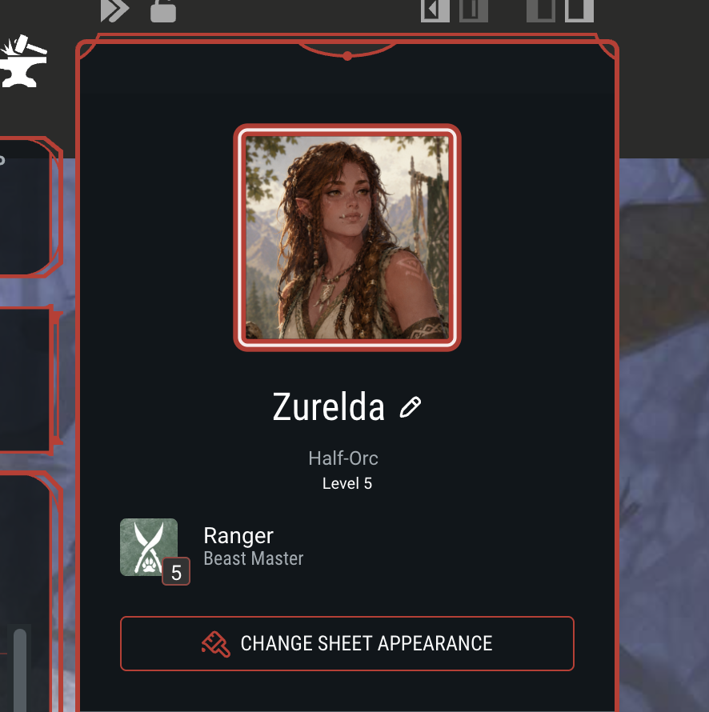
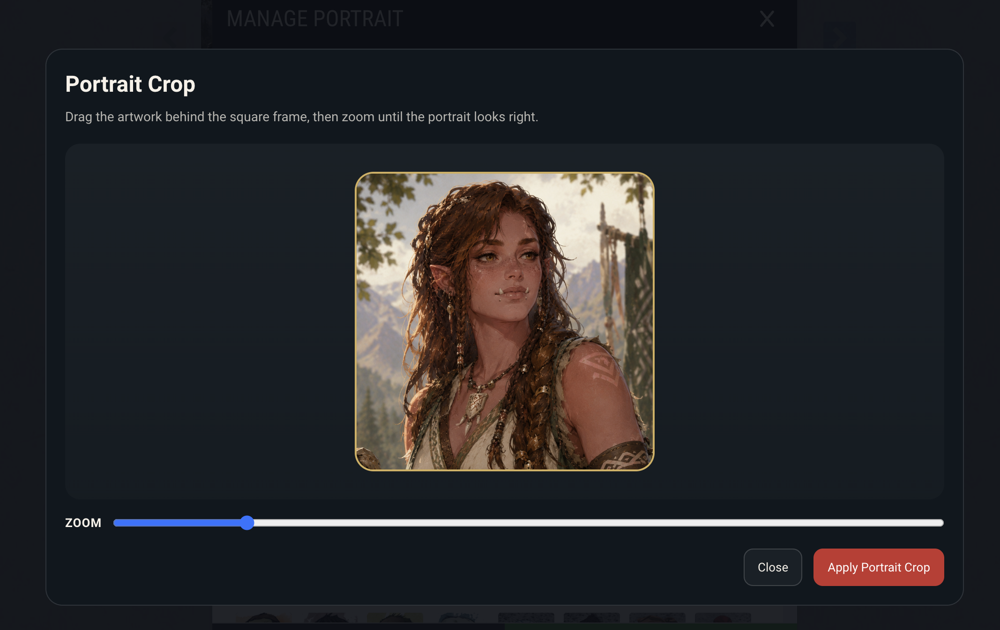
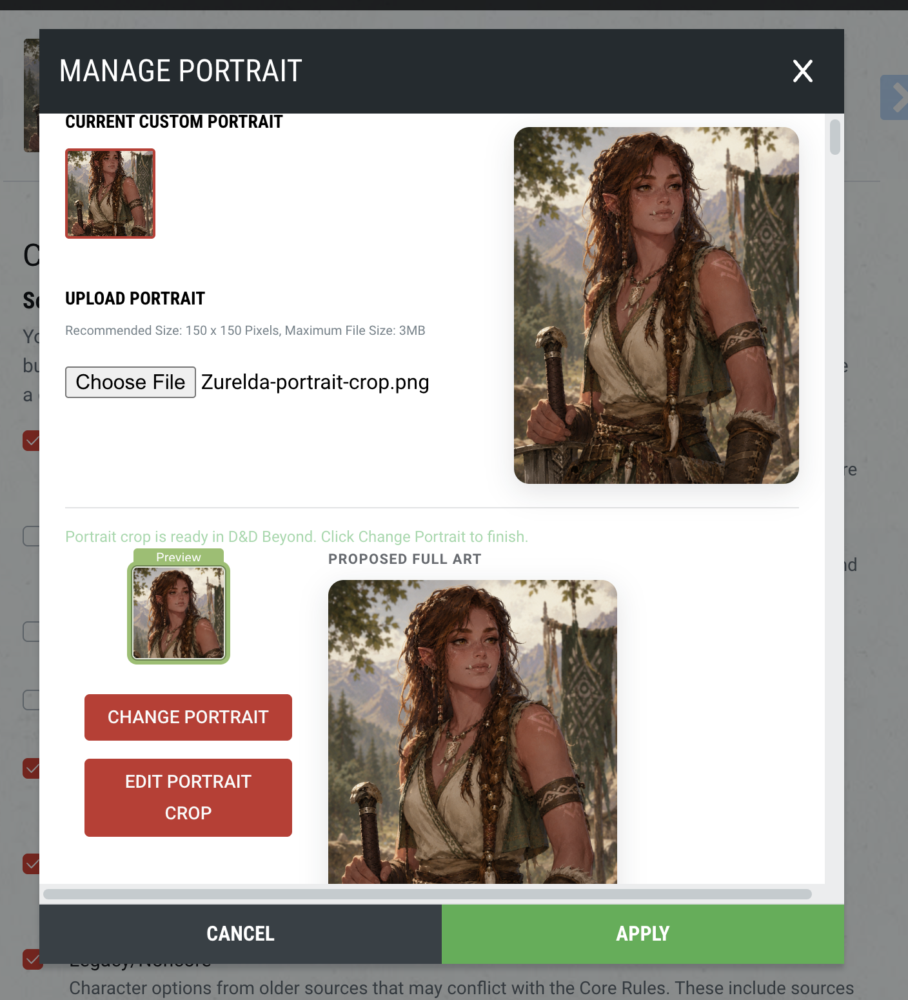
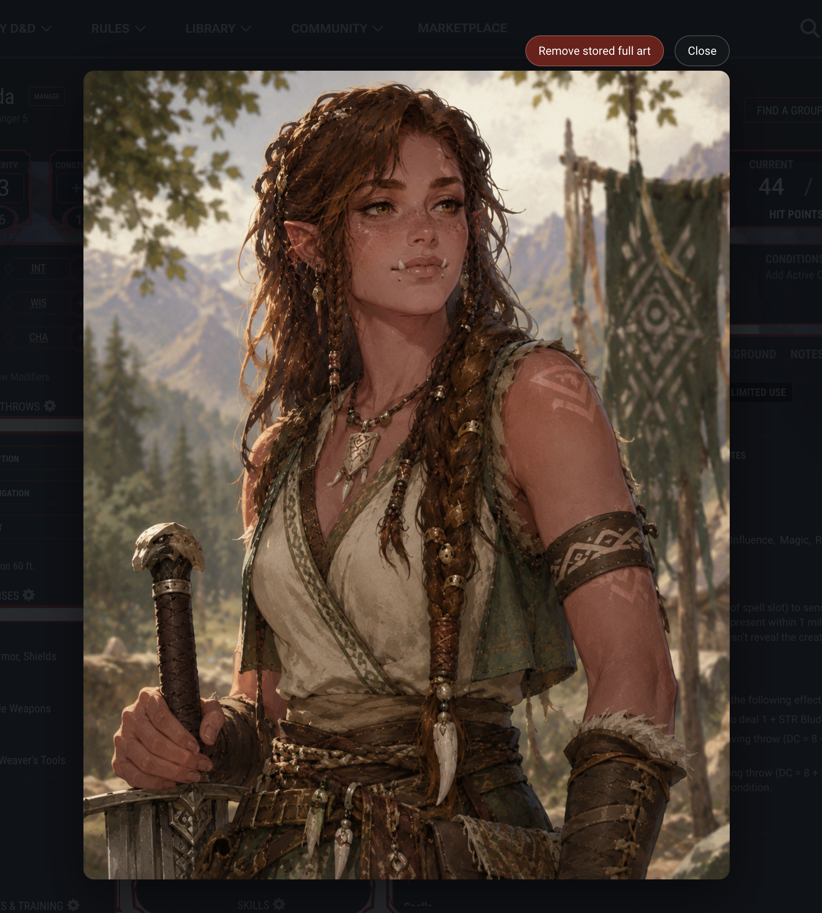

# Beyond Full Art

Beyond Full Art is a Chrome extension for D&D Beyond that lets you keep your character's full artwork while still using D&D Beyond's normal portrait system.

If you use a large illustration for your character, D&D Beyond usually reduces that down to a small cropped portrait. This extension keeps the original art available, lets you view it fullscreen, and helps you create a portrait crop without replacing D&D Beyond's UI.

## What It Does

- Opens your character art in a fullscreen viewer from the existing D&D Beyond portrait flow
- Saves one full-art image locally for each character
- Lets you crop a square portrait from that full artwork
- Works inside D&D Beyond's existing portrait management flow
- Keeps your artwork local to your browser

## Why Use It

D&D Beyond is great for running a character sheet, but it is not built around showing off the full illustration behind a portrait.

Beyond Full Art fills that gap:

- You can actually view your character art at a useful size
- You can keep a full illustration and a portrait crop together
- You do not need to manage a separate image workflow outside the sheet
- The extension adds to D&D Beyond instead of replacing it

## Screenshots

### Enter from the existing sheet UI



The extension starts from D&D Beyond's existing portrait flow instead of adding a separate launcher somewhere else.

### View current full art


When full art has already been saved locally, it appears alongside the current D&D Beyond portrait.

### Create or revise a portrait crop



The crop editor lets you frame a square portrait while keeping the original artwork intact.

### Compare the proposed portrait and full art before applying



Before you finish the portrait flow, you can preview both the portrait crop and the full art that will stay available in the extension.

### Open the art fullscreen



Once saved, the character's artwork can be opened at a much more useful size directly from the sheet.

## How To Install

There is no Chrome Web Store release yet.

### 1. Build the extension

```bash
nvm use
npm install
npm run build
```

If your local `node` path is not already active, use:

```bash
PATH="$HOME/.nvm/versions/node/$(cat .nvmrc)/bin:$PATH" npm run build
```

### 2. Load it in Chrome

1. Open `chrome://extensions`
2. Turn on `Developer mode`
3. Click `Load unpacked`
4. Select the repository's `dist/` folder

## How To Use

### View full art

1. Open a D&D Beyond character sheet.
2. Click the normal portrait to open D&D Beyond's portrait pane.
3. Click the portrait inside that pane.
4. The extension opens the image fullscreen.

### Save full art

1. Open D&D Beyond's portrait manager.
2. Choose a portrait image through D&D Beyond's normal upload flow.
3. Click D&D Beyond's native portrait confirmation button.
4. The extension saves that same source image locally as full art.

### Crop a portrait

1. Open the portrait manager after full art is available.
2. Choose `Crop portrait` or `Edit portrait crop`.
3. Drag and zoom until the portrait framing looks right.
4. Apply the crop.
5. Finish the D&D Beyond portrait flow if it asks you to confirm the change.

## Privacy

- Your artwork is stored locally in your browser
- The extension does not upload your art to an external service
- Removing the extension removes access to the stored local art
- There is currently no cloud sync

## Current Status

Available now:

- Fullscreen art viewer
- Local full-art storage
- Portrait crop workflow
- Manual removal of stored full art

Planned next:

- Better cleanup when a D&D Beyond character is deleted

## Known Limits

- No Chrome Web Store release yet
- Local art is tied to the browser where you installed the extension
- Only one active full-art image is stored per character right now

## For Developers

If you want the product and architecture details, start here:

- [docs/PRODUCT_SPEC.md](docs/PRODUCT_SPEC.md)
- [docs/ARCHITECTURE.md](docs/ARCHITECTURE.md)
- [docs/IMPLEMENTATION_PLAN.md](docs/IMPLEMENTATION_PLAN.md)
- [docs/DECISIONS.md](docs/DECISIONS.md)
- [docs/TESTING.md](docs/TESTING.md)

Repository-specific contributor guidance lives in [AGENTS.md](AGENTS.md).

## Disclaimer

This is an independent fan-made extension. It is not affiliated with or endorsed by D&D Beyond or Wizards of the Coast.
