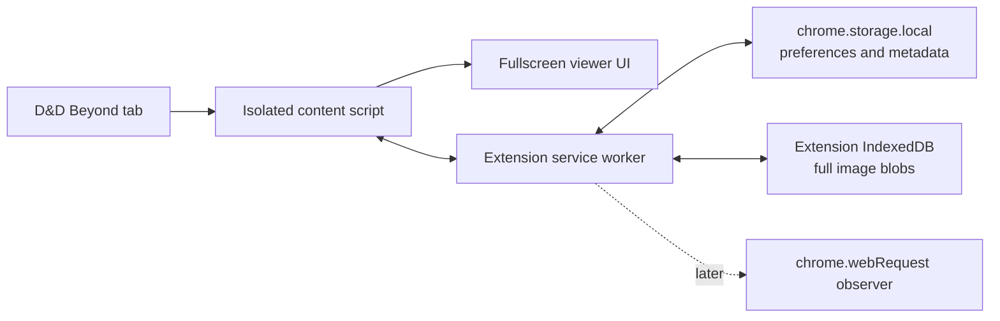
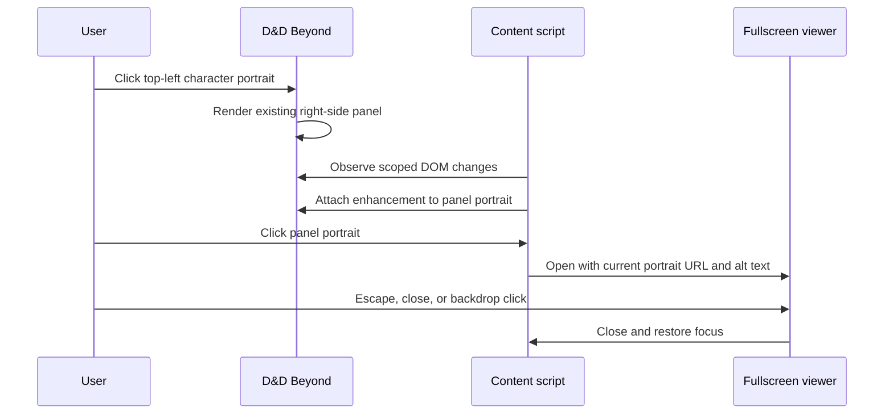
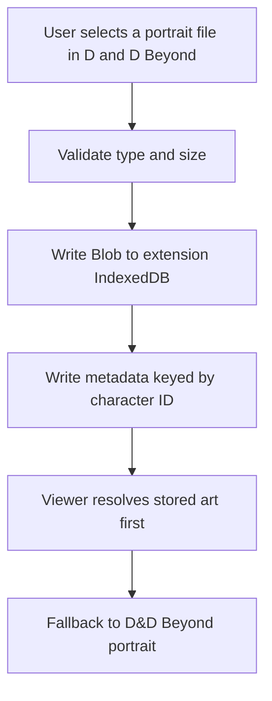

# Architecture

## High-level design

Use a Chrome Manifest V3 extension with a small content-script UI layer, an ephemeral background service worker for privileged browser events, and local extension storage.



The MVP uses only the D&D Beyond tab, content script, and viewer. The other components are added when their phase needs them.

## Recommended source boundaries

```text
src/
  background/
    service-worker.ts
  content/
    character-sheet-entry.ts
    characters-list-entry.ts
  features/
    fullscreen-viewer/
      viewer.ts
      viewer.css
      focus.ts
    character-art/
      art-service.ts
      art-types.ts
    crop-workflow/
      crop-workflow.ts
      crop-dialog.ts
      crop-math.ts
      crop-types.ts
    deletion-cleanup/
      cleanup-controller.ts
      cleanup-dialog.ts
      cleanup-preference.ts
  platform/
    chrome/
      messages.ts
      storage.ts
      indexed-db.ts
    dndbeyond/
      urls.ts
      selectors.ts
      portrait-adapter.ts
      portrait-manager-adapter.ts
      portrait-upload-handoff.ts
      delete-request-adapter.ts
  shared/
    result.ts
    logging.ts
```

This is a direction, not a demand for empty placeholder modules. Add a module when it owns real behavior.

## Phase 1 sequence



## D&D Beyond DOM adapter

D&D Beyond is an external application with client-rendered UI. Keep these details isolated:

- character-page URL recognition,
- character ID extraction,
- portrait-panel discovery,
- portrait-image discovery,
- any selector fallbacks.

The feature code should ask the adapter for a portrait target rather than importing raw selectors.

Recommended adapter shape:

```ts
export interface PortraitTarget {
  image: HTMLImageElement;
  clickSurface: HTMLElement;
}

export interface DndBeyondPortraitAdapter {
  findPanelPortrait(root: ParentNode): PortraitTarget | null;
  observePanelPortraits(callback: (target: PortraitTarget) => void): () => void;
}
```

Use a marker such as `data-bfa-enhanced="true"` to make enhancement idempotent.

### Phase 1 DOM hooks observed on 2026-08-06

From the provided right-side character manage-pane DOM capture, the current MVP can anchor on:

- panel root: `[data-testid="character-manage-pane"]`
- portrait image: `img.ddbc-character-avatar__portrait[alt="Character portrait"]`
- sidebar portal fallback root: `.ct-sidebar__portal`

The hashed `styles_*` class names in the same subtree should be treated as unstable build output and should not be primary selectors.

### Phase 2 DOM hooks observed on 2026-08-06

From the provided portrait-management captures for both the sheet sidebar flow and the builder modal flow, the current upload integration can anchor on:

- portrait manager root: `.ct-decoration-manager`
- upload section: `.ct-decoration-manager__upload`
- native file input: `.ct-decoration-manager__upload-file-input[type="file"]`

The current implementation passively listens to that D&D Beyond file input for preview state, then saves the selected file locally as full art only after the user activates D&D Beyond's native `Change Portrait` action. It does not replace the input, call `preventDefault()`, or modify D&D Beyond's portrait-upload request.

## Viewer design

The viewer is extension-owned DOM injected into the page.

Requirements:

- one overlay instance per document,
- `role="dialog"` and `aria-modal="true"`,
- visible close button,
- useful accessible name,
- focus trap or a deliberately tiny focus surface,
- focus restoration,
- body-scroll handling that is reversible,
- namespaced styles,
- reduced-motion support,
- cleanup on teardown.

Use the highest-quality URL already available from the target image when possible. Check `currentSrc` before `src`. Do not invent image-CDN URL transformations without verification.

## Phase 2 storage design



### Storage ownership

- `chrome.storage.local`: preferences, metadata, schema version, and small values.
- extension-origin IndexedDB: full image Blob data.
- content scripts must not use page-origin Web Storage or IndexedDB for extension data.
- access IndexedDB from an extension context, preferably the service worker or an extension page.

The transfer mechanism for large files between an injected file input and extension-origin storage requires a Phase 2 spike. Avoid prematurely encoding large files as base64 unless measurements show it is acceptable.

### Phase 2 implementation direction chosen on 2026-08-06

The current implementation uses:

- passive observation of D&D Beyond's portrait-upload file input,
- passive observation of D&D Beyond's native portrait-confirmation action,
- content script file validation,
- structured-clone transfer of an `ArrayBuffer` plus metadata through `chrome.runtime.sendMessage`,
- a Manifest V3 service worker as the storage owner,
- extension-origin IndexedDB for the stored image `Blob`,
- `chrome.storage.local` for per-character metadata.

Replacement writes use a new blob key first, then update metadata, then attempt to delete the old blob so a failed replacement does not destroy the prior image.

### Phase 3 implementation direction chosen on 2026-08-06

The current crop implementation uses:

- stored full art as the default source image for crop generation,
- the currently selected D&D Beyond portrait-upload file as the crop source when the user is preparing a replacement before native confirmation,
- extension-owned crop UI injected into the page,
- pure crop math for zoom/pan state and source-rect reconstruction,
- a separate portrait-crop metadata record in `chrome.storage.local`,
- a separate portrait-crop blob in extension-origin IndexedDB,
- invalidation of the saved crop whenever the stored full art is replaced,
- transient in-content-script crop state for a newly selected replacement file until D&D Beyond's native `Change Portrait` action commits the matching full art locally,
- programmatic handoff of the generated crop through D&D Beyond's existing portrait upload input.

This intentionally avoids rewriting the existing full-art metadata shape during the first crop slice.

### Proposed metadata

```ts
export type CharacterId = string;

export interface CharacterArtMetadata {
  characterId: CharacterId;
  fileName: string;
  mimeType: string;
  byteSize: number;
  width: number | null;
  height: number | null;
  createdAt: string;
  updatedAt: string;
  schemaVersion: 1;
}
```

Do not duplicate image bytes in `chrome.storage.local`.

## Phase 4 deletion signal

Preferred product behavior is network-driven because the extension cares about a completed character deletion, not the shape or text of a delete button.

```mermaid
sequenceDiagram
    participant DDB as D&D Beyond page
    participant SW as Service worker
    participant STORE as Local art store
    participant CS as Content script
    participant User

    DDB->>SW: DELETE request observed
    SW->>SW: Capture candidate character ID
    DDB-->>SW: Request completes successfully
    SW->>STORE: Check whether local art exists
    alt preference is ask
        SW->>CS: Show cleanup choice for character ID
        CS->>User: Delete art or Keep art
        User->>CS: Choose, optionally remember
        CS->>SW: Apply choice
    else preference is delete
        SW->>STORE: Delete local art
    else preference is keep
        SW->>STORE: Leave local art unchanged
    end
```



The exact method for obtaining the character ID must be validated. See `NETWORK_DELETE_RESEARCH.md`.

## Message design

Use a discriminated union and validate every message at runtime at the receiving boundary.

```ts
type ExtensionMessage =
  | { type: "art:get"; characterId: string }
  | { type: "art:delete"; characterId: string }
  | { type: "cleanup:prompt"; characterId: string }
  | {
      type: "cleanup:decision";
      characterId: string;
      decision: "delete" | "keep";
      remember: boolean;
    };
```

Do not trust custom DOM events or page-origin messages as privileged instructions. Validate type, shape, origin assumptions, and current tab context.

## Permissions strategy

Request permissions only when the corresponding phase ships.

### MVP

Likely needs only content-script match patterns for D&D Beyond character pages. No storage or web request permission is necessary solely to display the current image.

The implemented MVP should remain content-script-only. A background service worker is not required for the fullscreen portrait viewer.

### Full-art storage

Add `storage`. Consider `unlimitedStorage` only after measuring realistic image usage and documenting why it is needed.

The current implementation adds `storage` only. It does not request `unlimitedStorage`.

### Crop workflow

The current crop implementation adds no new Chrome permissions beyond Phase 2. It reuses the existing `storage` permission and the current character-page content-script surface.

### Delete cleanup

Add `webRequest` and narrow host permissions for both the D&D Beyond initiator and the character-service request origin if the validated implementation uses `chrome.webRequest`.

Never request `<all_urls>`.

## Failure behavior

When uncertain, preserve data and do less:

- selector not found: no page modification, development diagnostic only,
- image URL unavailable: do not open a broken viewer,
- request body cannot be decoded: do not delete art,
- deletion request fails: do not prompt or delete art,
- preference cannot be loaded: default to `ask`,
- storage deletion fails: show error and keep metadata consistent with recoverable bytes.
