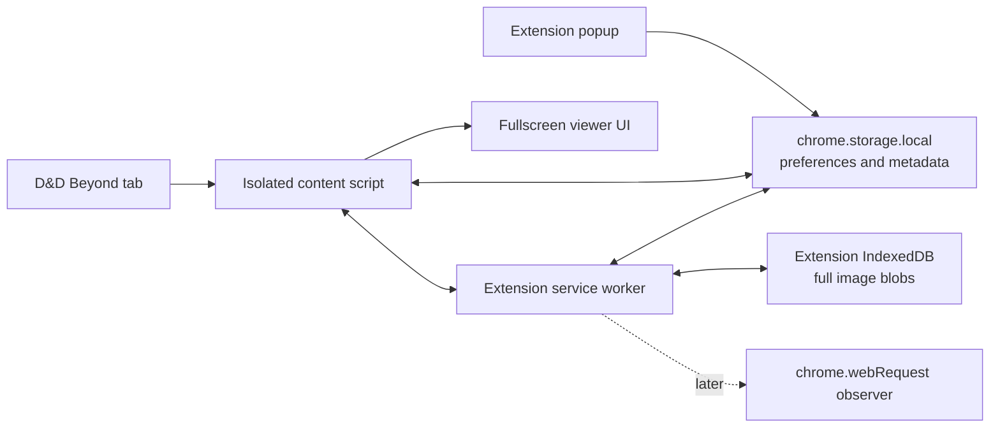
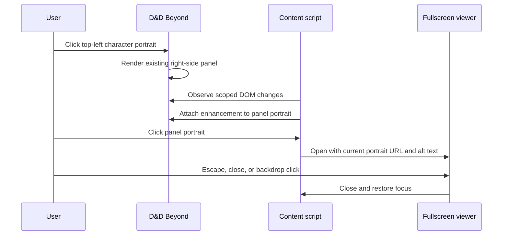
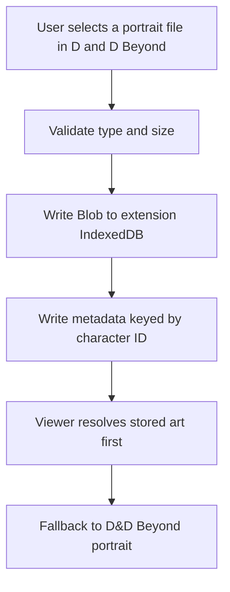
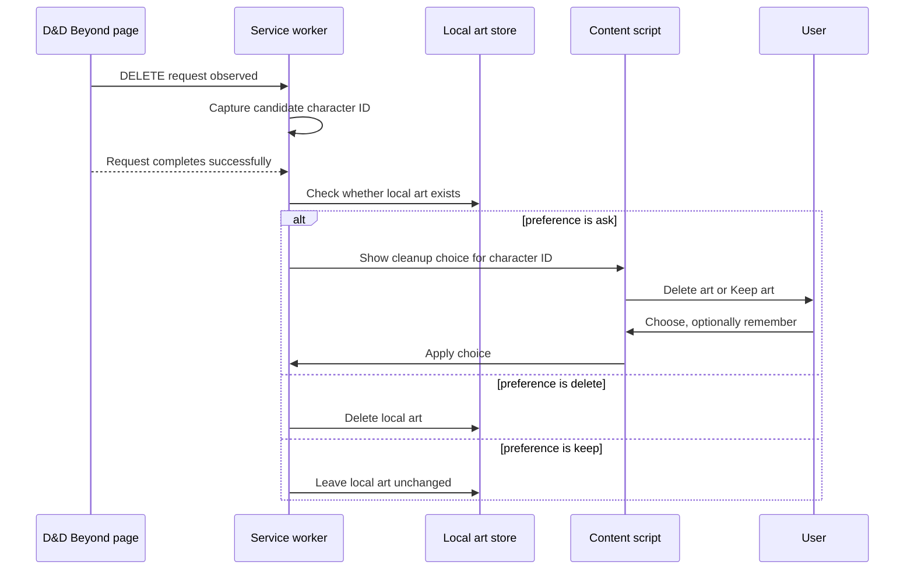

# Architecture

## High-level design

Use a Chrome Manifest V3 extension with a small content-script UI layer, an extension popup for lightweight settings, an ephemeral background service worker for privileged browser events, and local extension storage.



The shipped extension uses the D&D Beyond tab, content scripts, the settings popup, the service worker, `chrome.storage.local`, and extension-origin IndexedDB. The `chrome.webRequest` observer in the diagram is still future work for character-deletion cleanup.

## Source boundaries

```text
src/
  background/
    service-worker.ts
  content/
    card-portraits-entry.ts
    character-sheet-entry.ts
    character-sheet.ts
  features/
    campaign-card-portraits/
    character-art/
    character-journal/
    crop-workflow/
    fullscreen-viewer/
  platform/
    chrome/
      indexed-db.ts
      messages.ts
      storage.ts
    dndbeyond/
      campaign-card-portrait-adapter.ts
      character-sheet-tabs-adapter.ts
      portrait-adapter.ts
      portrait-manager-adapter.ts
      portrait-upload-handoff.ts
      selectors.ts
      urls.ts
  popup/
    settings.html
    settings.css
    settings.ts
  shared/
    dom.ts
    download.ts
    result.ts
    types.ts
```

Deletion cleanup is specified but not implemented. Do not add empty modules for it until that phase has real behavior. D&D Beyond selectors belong in `platform/dndbeyond`, not in feature modules.

## Phase 1 sequence



## D&D Beyond DOM adapter

D&D Beyond is an external application with client-rendered UI. The living description of the sheet, including Matilda Greywolf as the reference and live-QA character, is [docs/ddb-reference/README.md](ddb-reference/README.md). Read that instead of opening the live site. Every D&D Beyond selector the extension depends on is in `src/platform/dndbeyond/selectors.ts`. A renamed class is a one-line change there. `tests/dom/selector-health.test.ts` checks the code selectors against fixtures, and `tests/e2e/selector-health-live.spec.ts` checks the sheet selectors when a logged-in sheet is available.

Keep these details isolated:

- character-page URL recognition,
- character ID extraction,
- portrait-panel discovery,
- portrait-image discovery,
- any selector fallbacks.

The feature code should ask the adapter for a portrait target rather than importing raw selectors.

Recommended adapter shape:

```ts
export interface PortraitTarget {
  image: HTMLImageElement;
  clickSurface: HTMLElement;
}

export interface DndBeyondPortraitAdapter {
  findPanelPortrait(root: ParentNode): PortraitTarget | null;
  observePanelPortraits(callback: (target: PortraitTarget) => void): () => void;
}
```

Use a marker such as `data-bfa-enhanced="true"` to make enhancement idempotent.

### Phase 1 DOM hooks observed on 2026-08-06

From the provided right-side character manage-pane DOM capture, the current MVP can anchor on:

- panel root: `[data-testid="character-manage-pane"]`
- portrait image: `img.ddbc-character-avatar__portrait[alt="Character portrait"]`
- sidebar portal fallback root: `.ct-sidebar__portal`

The hashed `styles_*` class names in the same subtree should be treated as unstable build output and should not be primary selectors.

### Character card portrait adapter support added on 2026-10-12

The optional card portrait quality upgrade runs on campaign pages and the My
Characters collection page.

Campaign cards use the specific campaign card selectors under
`platform/dndbeyond/selectors.ts`. The My Characters page was not available for
live authenticated inspection in this implementation pass, so the adapter keeps
that assumption broad and centralized: it starts from validated
`/characters/{id}` links on the `/characters` collection route, finds the
nearest ancestor containing an inline D&D Beyond avatar background, and then
applies the same verified avatar URL transformation as campaign cards.

Manual release validation should confirm the My Characters DOM still exposes a
character-page link and an inline avatar background in the same card subtree.

From manual campaign-page inspection on 2026-10-12, the user's assigned
campaign character card can differ from other participant cards: its character
actions may live in the footer as `VIEW`, `EDIT`, `UNASSIGN`, and `LEAVE`
rather than exposing the same hidden header details link. The card portrait
adapter therefore accepts any link path containing `/characters/{id}` when it
associates a nearby avatar background with a character card.

The same inspection showed some campaign portraits using D&D Beyond thumbnail
paths such as `/avatars/thumbnails/{a}/{b}/60/60/{file}`. Query parameters like
`width=600` do not override those embedded thumbnail dimensions, so the URL
adapter normalizes thumbnail paths to `/avatars/{a}/{b}/{file}` before adding
the larger bounded query parameters.

### Character journal tab support added on 2026-10-12, refined on 2026-10-13

The character journal feature inserts one extension-owned `Journal` tab after
D&D Beyond's `Extras` tab on character sheet pages and renders journal content
inside the sheet content area.

The extension popup owns the feature toggle. The setting defaults to enabled,
is stored as `bfa.preferences.characterJournalEnabled` in
`chrome.storage.local`, and is observed by the character-sheet content script.
Turning the setting off removes the inserted tab and restores any hidden native
sheet content without deleting journal entries.

The current implementation centralizes this assumption in
`platform/dndbeyond/character-sheet-tabs-adapter.ts`. The adapter searches for
a visible `Extras` tab among stable interactive controls first, then falls back
to an exact-text `Extras` element inside a character-sheet tab strip. The live
2026-10-13 sheet exposed the tab row to accessibility as radio buttons while
the DOM did not present those tabs as ordinary radio inputs or tab roles, so the
adapter recognizes a bounded tab-strip ancestor by the expected sheet labels
(`Actions`, `Spells`, `Inventory`, `Features & Traits`, `Background`, `Notes`,
and `Extras`).

The adapter inserts a project-owned button immediately after the tab-strip item
that contains `Extras`, finds the sheet content host as the sibling panel next
to that tab strip, and marks the inserted tab with
`data-bfa-character-journal-tab="true"` for idempotency.

On the 2026-10-20 wide desktop capture of Matilda Greywolf, that tab row sits
at the top of the right-hand content box, not along the bottom of the page.
The content host is the body under the row. See
[docs/ddb-reference/README.md](ddb-reference/README.md).

When the journal tab is active, the extension hides the native sheet content
children in that host, appends `bfa-character-journal-section`, and restores the
native content when a native D&D Beyond tab is clicked.

Initial live inspection on 2026-10-13 found that the earlier fallback mounted
the journal under the `Extras` tab container and left the native sheet panel
visible. The refined adapter is covered by a live-shaped fixture with
non-semantic tab text nodes and a sibling content panel.

Owner testing on a dark character sheet on 2026-10-20 showed three further
behaviors, modeled in `LIVE_CHARACTER_SHEET_TABS_FIXTURE`:

- Tab items are plain `div.ddbc-tab-list__nav-item` elements. The active item
  uses `ddbc-tab-list__nav-item--is-active`. A pointerdown on the tab row can
  select a native tab before a click reaches an inserted button, and a click
  on the item padding hits the wrapper rather than the inner button. The
  content script claims that hit target in the capture phase and clears the
  native active class.
- Dark appearance is `ct-character-sheet--dark-mode` and `data-theme="dark"`.
  The journal samples that appearance, and the computed background when no
  explicit appearance is set, then sets color variables on the section.
- Version 1 mounted the list in the first `overflow: auto` pane inside the
  content region. That nested search is the bug version 2 removed. The current
  mount is the content region next to the tab strip, described under
  Character journal version 2 below.

A fresh capture of the live DOM is still the owner's check. The fixture records
the structure those bugs require, not a full copy of the sheet.

### Character journal version 2, checked 2026-10-20

Version 2 keeps the Journal tab and moves the note into a right-hand panel.
The list mounts on the content region next to the tab strip
(`.ddbc-tab-list__content` on the classic sheet). It does not search scrolling
descendants for a mount. While Journal is open, every other child of that
region is concealed with `display: none !important`. The `hidden` attribute
alone loses to the sheet's own `display` rule, which is why Extras used to
stay on screen inside the journal. Children the sheet inserts later are
concealed the same way, and the previous display is restored when Journal
closes.

The section toolbar is the Extras row: magnifier, search field, funnel, then
Manage Notes, on one line. The markup and classes are the ones observed on
the Extras filter (`SHEET_SECTION_FILTER_SELECTOR` in `selectors.ts`). A live
row is cloned when that tab is mounted; otherwise the same markup is built
from those strings so the sheet stylesheet can paint it. The site header
search is not used. Type filters sit behind the funnel and can be combined.
An empty selection shows every note. Manage Notes opens the note panel. That
is the only create path.

The panel is appended to `document.body`, beside the native sidebar portal, so
a sheet `overflow: hidden` cannot clip it. It is a second copy of the
Information Sidebar shell, not a child of the sheet's React tree. Checked
2026-10-21 on character 4741434, bundle `main.73ca5823.js`: the open dialog is
`ct-sidebar` plus the hashed frame classes, 340px, with the decorative border,
the gap, and the scroll body. The note uses `ct-note-manage-pane` and
`ct-sidebar__heading`. The note dialog is `position: fixed` at `right: 0` and
`z-index: 10001`. Its top follows the open native sidebar, and its height is
the viewport minus that top. Opening a note hides an open native sidebar.
Class strings live in `selectors.ts`. The snapshot is
`docs/ddb-reference/sidebar.md`. Hide closes the note. Prev and Next walk the
note history. Lock, overlay, and align are not rendered. The sheet's own
sidebar body is still a closed switch with no slot for extension content, so
nothing is mounted into it, and the portrait search skips `.bfa-journal-panel`.
The extension does not ship D&D Beyond's script. Title and note fields are the
full width of the content box inside its padding.

The visual source is Matilda Greywolf,
`https://www.dndbeyond.com/characters/172153137`, captured 2026-10-20 in light
and Underdark. The screenshots are in `docs/ddb-reference/`. A public light
sheet, `https://www.dndbeyond.com/characters/4741434` ("Book"), was loaded the
same day. It is the 2024 five-tab sheet (Actions, Spells, Inventory, Features
& Traits, Extras) and is saved at
`.agent/design/journal-v2/reference/live-sheet-light.png`. The tab matcher
accepts that shorter label set and the classic seven-tab set.

Theme comes from the sheet: `ct-theme-dark`, a class ending in `dark-mode`,
`data-theme` or `data-appearance`, then background luminance. The journal does
not read `prefers-color-scheme`. Accent, border, and the active-tab underline
come from the computed style of an existing frame or the active tab. Fallback
tokens are used when a sample is missing. A white input is not treated as an
Underdark field.

Journal D&D Beyond selectors live in the Character journal group of
`src/platform/dndbeyond/selectors.ts`. `tests/dom/selector-health.test.ts`
names the selector and the feature that breaks when a fixture no longer matches.

### Phase 1 DOM hooks observed on 2026-10-10

From live D&D Beyond character sheet inspection, the right-side sheet panel may no longer expose `[data-testid="character-manage-pane"]`, and the displayed portrait may be a `div.ddbc-character-avatar__portrait` with the image URL in CSS `background-image` rather than an `img`.

Current fallback behavior:

- prefer the legacy `[data-testid="character-manage-pane"]` panel when present,
- otherwise use the accessible `[aria-label="Information Sidebar"]` panel when present,
- prefer the legacy portrait `img`, then fall back to the largest `.ddbc-character-avatar__portrait` surface in the panel,
- resolve viewer images from `currentSrc`/`src` for images or CSS `background-image` for current portrait surfaces.

Do not depend on the observed hashed `styles_avatar__*` class; it is used only in tests to distinguish fixture elements.

### Phase 2 DOM hooks observed on 2026-08-06

From the provided portrait-management captures for both the sheet sidebar flow and the builder modal flow, the current upload integration can anchor on:

- portrait manager root: `.ct-decoration-manager`
- upload section: `.ct-decoration-manager__upload`
- native file input: `.ct-decoration-manager__upload-file-input[type="file"]`

The current implementation passively listens to that D&D Beyond file input for preview state, then saves the selected file locally as full art only after the user activates D&D Beyond's native `Change Portrait` action. It does not replace the input, call `preventDefault()`, or modify D&D Beyond's portrait-upload request.

As of live inspection on 2026-10-10, D&D Beyond's sheet-sidebar appearance flow has changed to a "Current Decorations" / "Browse Decorations" interface. The old `.ct-decoration-manager` upload hooks were not visible in that first-level sidebar view, so the full-art upload adapter likely needs renewed live-site research before changing the upload flow.

## Viewer design

The viewer is extension-owned DOM injected into the page.

Requirements:

- one overlay instance per document,
- `role="dialog"` and `aria-modal="true"`,
- visible close button,
- useful accessible name,
- focus trap or a deliberately tiny focus surface,
- focus restoration,
- body-scroll handling that is reversible,
- namespaced styles,
- reduced-motion support,
- cleanup on teardown.

Use the highest-quality URL already available from the target image when possible. Check `currentSrc` before `src`. Do not invent image-CDN URL transformations without verification.

## Phase 2 storage design



### Storage ownership

- `chrome.storage.local`: preferences, metadata, schema version, and small values.
- extension-origin IndexedDB: full image Blob data.
- content scripts must not use page-origin Web Storage or IndexedDB for extension data.
- access IndexedDB from an extension context, preferably the service worker or an extension page.

The transfer mechanism for large files between an injected file input and extension-origin storage requires a Phase 2 spike. Avoid prematurely encoding large files as base64 unless measurements show it is acceptable.

### Phase 2 implementation direction chosen on 2026-08-06

The current implementation uses:

- passive observation of D&D Beyond's portrait-upload file input,
- passive observation of D&D Beyond's native portrait-confirmation action,
- content script file validation,
- structured-clone transfer of an `ArrayBuffer` plus metadata through `chrome.runtime.sendMessage`,
- a Manifest V3 service worker as the storage owner,
- extension-origin IndexedDB for the stored image `Blob`,
- `chrome.storage.local` for per-character metadata.

Replacement writes use a new blob key first, then update metadata, then attempt to delete the old blob so a failed replacement does not destroy the prior image.

The popup can request a full-art inventory through the same validated runtime
message boundary. It lists metadata from `chrome.storage.local`, builds normal
D&D Beyond character links from stored character IDs, then uses the existing
image-data and delete operations for per-item download and deletion. Downloads
use a temporary same-page anchor with a Blob URL and do not require Chrome's
`downloads` permission.

## Character journal storage

The character journal is extension-local and does not write to D&D Beyond
notes, backstory, or page-origin storage.

Journal note text is stored in `chrome.storage.local`. Photo bytes are stored
in the same extension-origin IndexedDB database as full art, under blob keys
prefixed with `bfa.journal.image.`. The content script sends those bytes
through a validated runtime message. The service worker is the only writer.
The 3 MB ceiling is on the stored blob, not on `chrome.storage.local`. A new
file larger than that, up to 25 MB, is drawn down to a 2048px long edge and
re-encoded before the message. Photos already stored are read unchanged.
`unlimitedStorage` is not requested. The extension origin still shares the
browser's extension storage quota, about 10 MB, and a full quota is reported
on the note with the image size.

```text
bfa.preferences.characterJournalEnabled
bfa.characterJournal.schemaVersion
bfa.characterJournal.entries.<characterId>
bfa.characterJournal.backup.v1.<characterId>
```

Each character key stores an array of notes. Writes re-read that array and
merge by id, keeping the newer `updatedAt`, so a stale snapshot does not erase
another window's note. A save whose loaded `updatedAt` is older than the stored
copy is refused. Records that fail validation stay in the array and are omitted
from the list, with a count shown in the journal.

New notes are schema version 2:

```ts
interface JournalNote {
  id: string;
  characterId: string;
  title: string;
  body: string;
  type: 'session' | 'npc' | 'place' | 'item' | 'quest' | 'backstory' | 'unset';
  images: JournalImage[];
  needsDetails: boolean;
  questStatus: null;
  sessionDate: string | null;
  featuredImageId: string | null;
  createdAt: string;
  updatedAt: string;
  schemaVersion: 2;
}
```

`body` is markdown the player typed. `images` store the blob key, file name,
and type. They do not store bytes. Opening a character that still has version 1
entries writes `bfa.characterJournal.backup.v1.<characterId>` first, and that
backup is never overwritten. The version 1 shape is:

```ts
interface CharacterJournalEntry {
  id: string;
  characterId: string;
  title: string;
  blocks: CharacterJournalBlock[];
  createdAt: string;
  updatedAt: string;
  schemaVersion: 1;
}
```

An entry can contain one text block and any number of image blocks. Image
blocks store the blob key, file name, MIME type, byte size, and dimensions.
They do not store image bytes. Schema version remains 1 so text-only entries
saved before photos shipped still load.

### Phase 3 implementation direction chosen on 2026-08-06

The current crop implementation uses:

- stored full art as the default source image for crop generation,
- the currently selected D&D Beyond portrait-upload file as the crop source when the user is preparing a replacement before native confirmation,
- extension-owned crop UI injected into the page,
- pure crop math for zoom/pan state and source-rect reconstruction,
- a separate portrait-crop metadata record in `chrome.storage.local`,
- a separate portrait-crop blob in extension-origin IndexedDB,
- invalidation of the saved crop whenever the stored full art is replaced,
- transient in-content-script crop state for a newly selected replacement file until D&D Beyond's native `Change Portrait` action commits the matching full art locally,
- programmatic handoff of the generated crop through D&D Beyond's existing portrait upload input.

This intentionally avoids rewriting the existing full-art metadata shape during the first crop slice.

### Proposed metadata

```ts
export type CharacterId = string;

export interface CharacterArtMetadata {
  characterId: CharacterId;
  fileName: string;
  mimeType: string;
  byteSize: number;
  width: number | null;
  height: number | null;
  createdAt: string;
  updatedAt: string;
  schemaVersion: 1;
}
```

Do not duplicate image bytes in `chrome.storage.local`.

## Phase 4 deletion signal

Preferred product behavior is network-driven because the extension cares about a completed character deletion, not the shape or text of a delete button.



The exact method for obtaining the character ID must be validated. See `NETWORK_DELETE_RESEARCH.md`.

## Message design

Use a discriminated union and validate every message at runtime at the receiving boundary.

```ts
type ExtensionMessage =
  | { type: "art:get"; characterId: string }
  | { type: "art:delete"; characterId: string }
  | { type: "cleanup:prompt"; characterId: string }
  | {
      type: "cleanup:decision";
      characterId: string;
      decision: "delete" | "keep";
      remember: boolean;
    };
```

Do not trust custom DOM events or page-origin messages as privileged instructions. Validate type, shape, origin assumptions, and current tab context.

## Permissions strategy

Request permissions only when the corresponding phase ships.

### MVP

Likely needs only content-script match patterns for D&D Beyond character pages. No storage or web request permission is necessary solely to display the current image.

The implemented MVP should remain content-script-only. A background service worker is not required for the fullscreen portrait viewer.

### Full-art storage

Add `storage`. Consider `unlimitedStorage` only after measuring realistic image usage and documenting why it is needed.

The current implementation adds `storage` only. It does not request `unlimitedStorage`.

### Crop workflow

The current crop implementation adds no new Chrome permissions beyond Phase 2. It reuses the existing `storage` permission and the current character-page content-script surface.

### Delete cleanup

Add `webRequest` and narrow host permissions for both the D&D Beyond initiator and the character-service request origin if the validated implementation uses `chrome.webRequest`.

Never request `<all_urls>`.

## Failure behavior

When uncertain, preserve data and do less:

- selector not found: no page modification, development diagnostic only,
- image URL unavailable: do not open a broken viewer,
- request body cannot be decoded: do not delete art,
- deletion request fails: do not prompt or delete art,
- preference cannot be loaded: default to `ask`,
- storage deletion fails: show error and keep metadata consistent with recoverable bytes.
